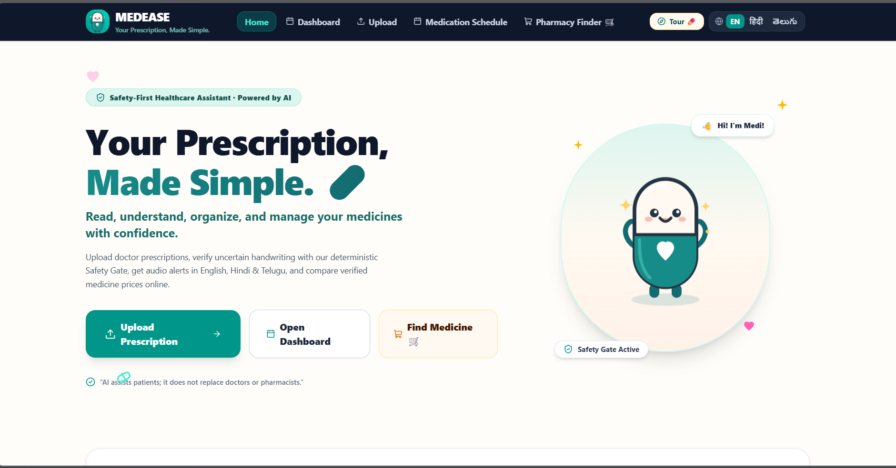
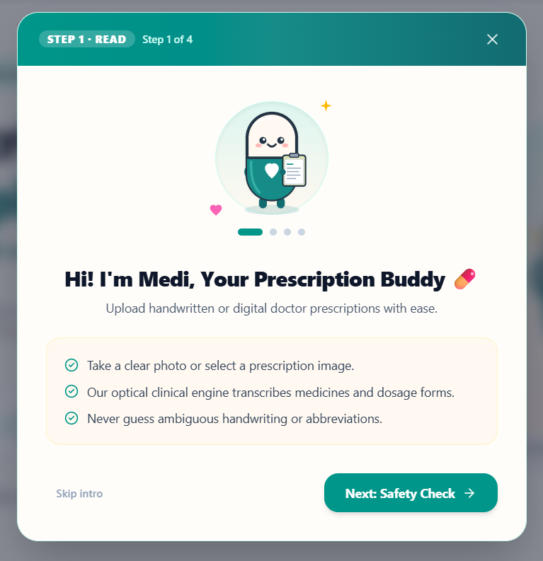
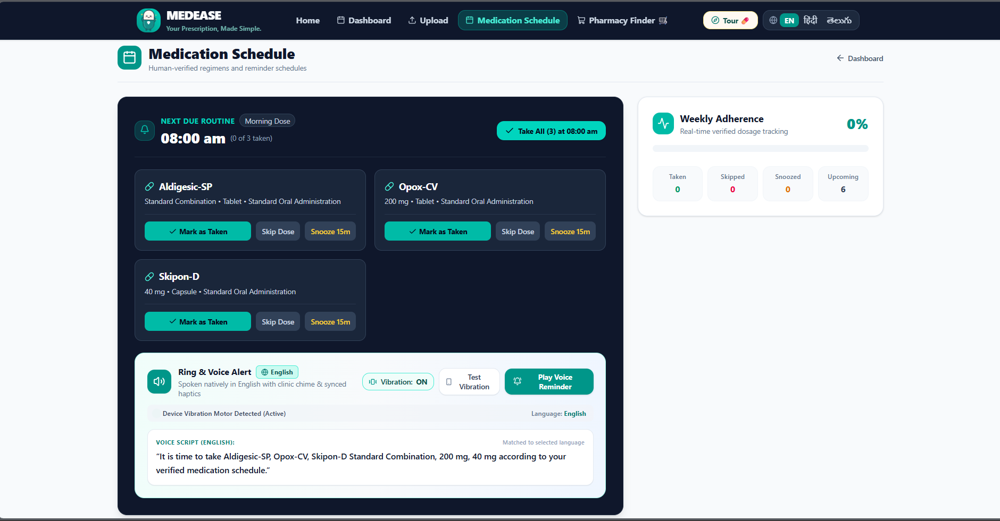
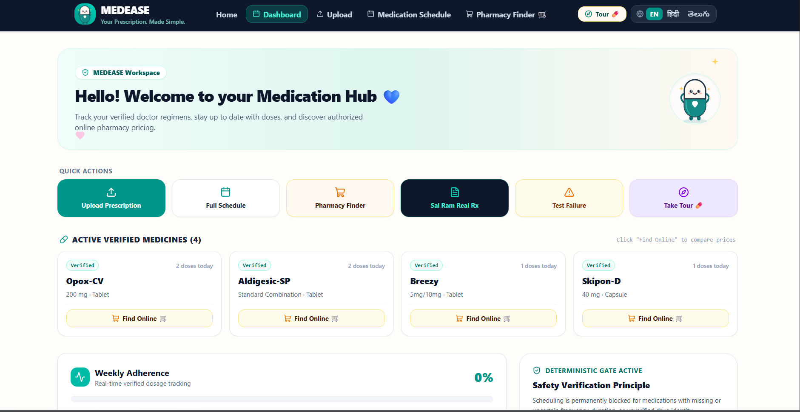

># MEDEASE🛡️💊
### Your Prescription, Made Simple.
> **Read · Verify · Understand · Remember · Stay Safe**  
MEDEASE is a safety-first, AI-assisted prescription understanding and medication management platform designed to make medical prescriptions easier to read, understand, organize, and follow.

From handwritten prescription interpretation to multilingual assistance, medication reminders, and online pharmacy discovery, MEDEASE brings essential medication-management tools into one friendly digital experience.

At the heart of MEDEASE is a simple principle:

> **When handwriting is uncertain, verify first. Never guess medication instructions.**

MEDEASE combines prescription processing with a deterministic Safety Gate, human verification, accessible language support, and a friendly mascot named **Medi**.

**Project Type:** Healthcare Technology / AI-Assisted Medication Management

**Developed For:** DeVert-A-Thon 2026

**Status:** Healthcare technology prototype

> ⚕️ MEDEASE assists patients with understanding and organizing prescription information. It does not replace doctors, pharmacists, or qualified healthcare professionals.

---

## 🌍 1. The Problem

Handwritten medical prescriptions can be difficult to understand, particularly when patients encounter unfamiliar medicine names, abbreviations, or complicated dosage instructions.

This creates several challenges:

- Difficulty interpreting handwritten prescriptions.
- Language barriers when understanding medication information.
- Risk of misreading medicine names or instructions.
- Difficulty remembering scheduled doses.
- Limited accessibility for patients who prefer audio guidance.
- Challenges finding medicines through online pharmacies.
- Fragmented tools for prescription management and medication tracking.

A prescription scanner alone cannot solve these problems. Extracted text may be incomplete or incorrect, and an unverified interpretation should never become a medication reminder.

---

## 💡 2. Our Solution

MEDEASE provides an integrated prescription assistance experience built around four actions:

### 📖 READ
Upload a handwritten or digital prescription for text extraction and structured review.

### 🛡️ VERIFY
Flag unclear medication information and require human verification before uncertain instructions can be used for scheduling.

### 🌐 UNDERSTAND
Access medication information and language assistance in English, Hindi, and Telugu.

### ⏰ REMEMBER
Organize verified medication schedules with voice reminders, dose tracking, and adherence summaries.

MEDEASE also provides pharmacy discovery tools to help users explore online medicine purchasing options.

---

## ✨ 3. Core Features

### 📸 3.1 Prescription Upload & Interpretation

Users can upload images of handwritten or digital medical prescriptions.

The intended workflow includes:

- Prescription image upload.
- Optical text extraction.
- Identification of medication-related information.
- Structured review of extracted fields.
- Detection of ambiguous or incomplete information.
- Human verification before scheduling.

The platform is designed to avoid inventing unreadable medicine names, strengths, or instructions.

### 🛡️ 3.2 Deterministic Safety Gate

**The Safety Gate is the central safety feature of MEDEASE.**

Rather than automatically accepting every extracted instruction, the application emphasizes verification before medication scheduling.

Its intended principles are:

- Never guess unclear handwriting.
- Never invent missing dosage information.
- Never silently modify prescription instructions.
- Flag uncertain or incomplete fields.
- Require verification of critical medication information.
- Block scheduling when essential instructions remain unverified.

**Core Principle:**

> No verified instructions, no automatic medication schedule.

The Safety Gate supports safer information handling but does not independently establish that a prescription is medically appropriate.

### 🌐 3.3 Multilingual Accessibility

MEDEASE includes an interface language selector for:

| Language | Display |
|---|---|
| English | EN |
| Hindi | हिंदी |
| Telugu | తెలుగు |

The language switcher is available directly in the main navigation.

The platform aims to make prescription information and medication guidance easier to access for users who prefer regional languages.

### 🔊 3.4 Voice-Based Medication Reminders

MEDEASE includes a medication reminder interface with spoken alerts.

The demonstrated interface features:

- Scheduled medication reminders.
- English-language voice reminder playback.
- A voice reminder preview.
- Device vibration detection.
- Test vibration control.
- Fifteen-minute snooze actions.
- Individual medication dose actions.

Voice and vibration behavior depends on browser capabilities, device support, permissions, and application state.

### 📅 3.5 Medication Schedule

The Medication Schedule page organizes verified medicine instructions into a daily routine.

**Visible capabilities include:**

- Next scheduled medication time.
- Medicine name and strength.
- Medication dosage form.
- Mark as Taken.
- Skip Dose.
- Snooze 15m.
- Mark all scheduled medicines as taken.
- Weekly adherence summary.

The screenshot demonstrates a morning routine scheduled for 08:00 AM.

### 📊 3.6 Medication Adherence Tracking

MEDEASE provides a weekly medication adherence panel.

The dashboard displays:

| Indicator | Purpose |
|---|---|
| Taken | Recorded completed doses |
| Skipped | Recorded skipped doses |
| Snoozed | Postponed medication reminders |
| Upcoming | Remaining scheduled doses |
| Weekly Adherence | Summary of recorded dose completion |

These indicators help users review their medication-taking activity.

### 💊 3.7 Medication Dashboard

The medication dashboard acts as a centralized workspace.

It provides quick access to:

- Prescription upload.
- Full medication schedule.
- Pharmacy Finder.
- Demonstration prescription workflow.
- Failure testing.
- Guided application tour.

The dashboard also displays active verified medication cards with medicine names, strengths, dosage forms, and daily dose information.

### 🛒 3.8 Pharmacy Finder

MEDEASE includes pharmacy discovery and online medicine lookup actions.

The interface provides a **Find Online** option on medication cards and a dedicated Pharmacy Finder navigation item.

The intended experience is to help users explore medicine availability and pricing through online pharmacy sources.

Availability, price accuracy, and purchasing functionality depend on the integrated pharmacy services.

### 🧸 3.9 Medi — Your Prescription Buddy

MEDEASE introduces **Medi**, a friendly capsule mascot that helps make the healthcare interface more approachable.

Medi appears throughout the application, including:

- The homepage.
- Guided onboarding.
- Dashboard illustrations.
- Prescription workflow explanations.

Medi is designed to reduce the intimidation of unfamiliar healthcare technology while keeping safety instructions clear.

### 🧭 3.10 Interactive Guided Tour

MEDEASE includes a four-step onboarding tour.

The first visible step introduces the prescription reading workflow and explains:

- How to upload a prescription image.
- How the optical prescription engine processes information.
- Why unclear handwriting must not be guessed.

The interface includes navigation controls and an option to skip the introduction.

### 🎨 3.11 Friendly & Accessible Design

MEDEASE uses a distinctive healthcare-inspired visual identity.

**Design elements include:**

- Teal and mint-green accents.
- Deep navy navigation and medication panels.
- Warm off-white backgrounds.
- Soft pastel illustrations.
- Rounded cards and buttons.
- Clear typography.
- Friendly icons and small decorative elements.
- Consistent Medi mascot illustrations.

The design aims to balance clinical clarity with a welcoming user experience.

---

## 📸 4. Application Screenshots

### 🏠 4.1 Homepage — Your Prescription, Made Simple



The homepage introduces the platform's core purpose through a welcoming interface.

**Highlights:**
- MEDEASE branding and tagline.
- Medi mascot illustration.
- Safety-first healthcare messaging.
- Upload Prescription action.
- Dashboard access.
- Pharmacy Finder.
- English, Hindi, and Telugu language selection.
- Guided tour access.

### 🧸 4.2 Meet Medi — Interactive Onboarding



The onboarding interface introduces Medi and explains the prescription assistance workflow.

**Highlights:**
- Four-step guided introduction.
- Prescription reading explanation.
- Human verification emphasis.
- Friendly visual guidance.
- Next-step navigation.
- Skip intro option.

### ⏰ 4.3 Medication Schedule & Voice Reminders



The Medication Schedule page displays verified medication routines and adherence information.

**Highlights:**
- Next scheduled routine.
- Individual medication cards.
- Mark as Taken, Skip Dose, and Snooze actions.
- Weekly adherence indicators.
- Voice reminder playback.
- Device vibration controls.
- Spoken reminder preview.

### 💊 4.4 Medication Dashboard



The dashboard provides a central workspace for managing verified prescription information.

**Highlights:**
- Welcome banner featuring Medi.
- Quick action buttons.
- Active verified medicine cards.
- Medicine strength and dosage form.
- Online pharmacy lookup.
- Weekly adherence information.
- Safety Gate status.

**Screenshot Note:** The medication names, strengths, and schedules shown are examples from the demonstrated interface and must not be treated as medical recommendations.

---

## 🏗️ 5. Conceptual System Architecture

The following architecture represents the intended workflow of MEDEASE. The precise implementation should be confirmed against the source code.

```text
             ┌──────────────────────────┐
             │       User Interface     │
             │   Upload / Dashboard     │
             └─────────────┬────────────┘
                           │
                           ▼
             ┌──────────────────────────┐
             │  Prescription Processing │
             │  Image / Text Extraction │
             └─────────────┬────────────┘
                           │
                           ▼
             ┌──────────────────────────┐
             │ Structured Prescription  │
             │      Information         │
             └─────────────┬────────────┘
                           │
                           ▼
             ┌──────────────────────────┐
             │   Deterministic Safety   │
             │           Gate           │
             └─────────────┬────────────┘
                           │
                    Human Verification
                           │
                           ▼
             ┌──────────────────────────┐
             │  Verified Medication     │
             │       Information        │
             └─────────────┬────────────┘
                           │
              ┌────────────┼────────────┐
              ▼            ▼            ▼
       ┌──────────┐ ┌──────────┐ ┌──────────┐
       │ Schedule │ │ Language │ │ Pharmacy │
       │ & Alerts │ │ Support  │ │ Discovery│
       └──────────┘ └──────────┘ └──────────┘
```

---

## 🔄 6. Prescription Processing Workflow

### Step 1 — Upload

The user uploads a prescription image.

### Step 2 — Extract

The prescription processing engine attempts to identify relevant medication information.

### Step 3 — Review

Extracted information is organized for review, with uncertain fields identified.

### Step 4 — Verify

The user or an appropriate authorized reviewer confirms critical prescription details against the original instructions.

### Step 5 — Schedule

Verified instructions can be organized into a medication schedule.

### Step 6 — Remind

The application provides medication reminders based on the verified schedule.

### Step 7 — Track

Users can record medication activity and review adherence summaries.

**Safety Rule:** The application must not infer missing medication instructions or independently prescribe treatment.

---

## 🔐 7. Safety-First Design

MEDEASE is built around the principle that healthcare information requires more than simple text extraction.

| Safety Principle | Intended Behavior |
|---|---|
| Unclear handwriting | Flag for verification |
| Missing medicine strength | Do not invent a value |
| Missing dosage instructions | Block unsupported scheduling |
| Ambiguous abbreviations | Require clarification |
| Unverified instructions | Prevent automatic scheduling |
| Medication explanations | Provide general information, not diagnosis |
| Prescription changes | Refer to qualified healthcare professionals |
| Automated outputs | Preserve human oversight |

The Safety Gate is an information-verification mechanism, not a substitute for clinical review.

---

## 🌐 8. Language & Accessibility

MEDEASE aims to support users with different language and accessibility needs.

The interface visibly supports English, Hindi, and Telugu selection.

Accessibility-focused features include:

- Language switching.
- Voice reminder controls.
- Device vibration options.
- Clear medication cards.
- Simple navigation.
- Large, recognizable action buttons.
- Guided onboarding.
- Friendly explanatory text.

Support for individual languages and device features should be tested before production use.

---

## 🧪 9. Demonstration Workflow

A suggested project demonstration:

1. Open the MEDEASE homepage and introduce Medi.
2. Launch the guided onboarding tour.
3. Demonstrate prescription upload.
4. Explain how extracted medication information is reviewed.
5. Show the Safety Gate and its verification requirements.
6. Navigate to the medication dashboard.
7. Explore the verified medication cards.
8. Open the Medication Schedule page.
9. Demonstrate dose tracking and reminder controls.
10. Play the voice reminder preview.
11. Switch between English, Hindi, and Telugu.
12. Explore the Pharmacy Finder interface.
13. Explain how uncertain instructions are prevented from becoming unverified schedules.

The dashboard also visibly includes a failure-testing action, which can be useful for demonstrating safety behavior when supported by the implementation.

---

## 🎯 10. Intended Users & Applications

MEDEASE explores assistive healthcare technology for:

- Patients managing prescription instructions.
- Older adults who benefit from clear reminders.
- Users who prefer regional-language interfaces.
- Caregivers assisting with medication organization.
- People who find handwritten prescriptions difficult to understand.
- Healthcare technology education and research.
- Academic projects and hackathon demonstrations.

---

## 🔮 11. Future Enhancements

Potential future developments include:

### Enhanced Handwriting Recognition
Improve robustness across handwriting styles, image quality, and prescription formats.

### Expanded Regional Language Support
Introduce additional Indian languages and accessible audio explanations.

### Caregiver Assistance
Enable permission-based caregiver access to verified schedules.

### Medication Information Integration
Connect verified medication reference sources for general-purpose medicine information.

### Improved Pharmacy Comparison
Integrate authorized pharmacy services for current availability and pricing.

### Accessibility Improvements
Enhance screen-reader support, keyboard navigation, and low-vision usability.

### Secure Synchronization
Explore secure synchronization of verified schedules across supported devices.

### Clinical Evaluation
Conduct structured usability, reliability, and safety evaluations with qualified healthcare professionals.

These are future directions, not claims of currently implemented functionality.

---

## ⚕️ 12. Medical Disclaimer & Responsible Use

MEDEASE is an educational healthcare technology prototype.

It is not a certified medical device and does not replace professional medical judgment.

- Do not use extracted text as authoritative prescription information without verification.
- Do not change medication strength, frequency, or dosage based on application output.
- Confirm unclear instructions with a qualified healthcare professional.
- Medication reminders are organizational aids, not medical instructions.
- Pharmacy availability and prices require confirmation from their respective providers.
- Sensitive prescription information must be handled using appropriate privacy and security controls.

**The purpose of MEDEASE is to support understanding, organization, and informed medication management — not to diagnose, prescribe, or independently make clinical decisions.**

---

### 💊 MEDEASE
**Your Prescription, Made Simple.**

**Read. Verify. Understand. Remember.**

*Making prescription information easier to understand, one verified step at a time.*
